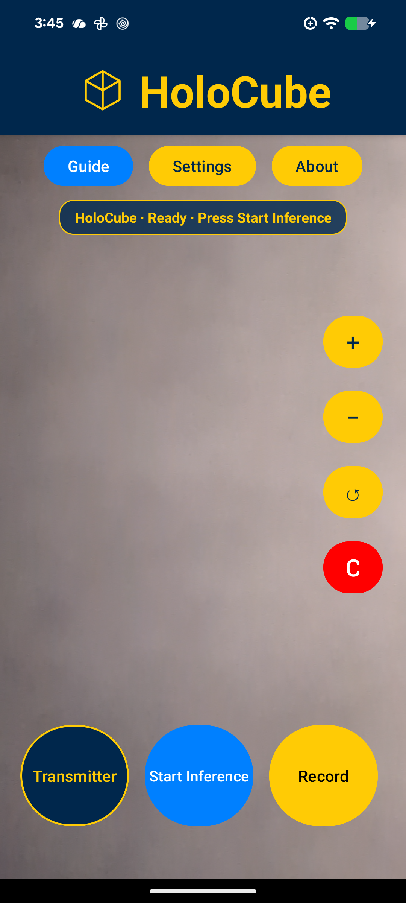
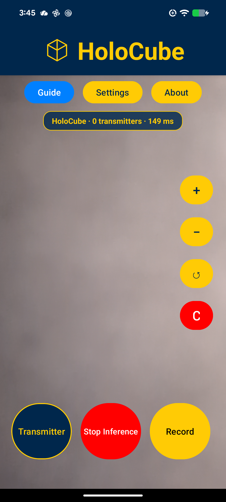
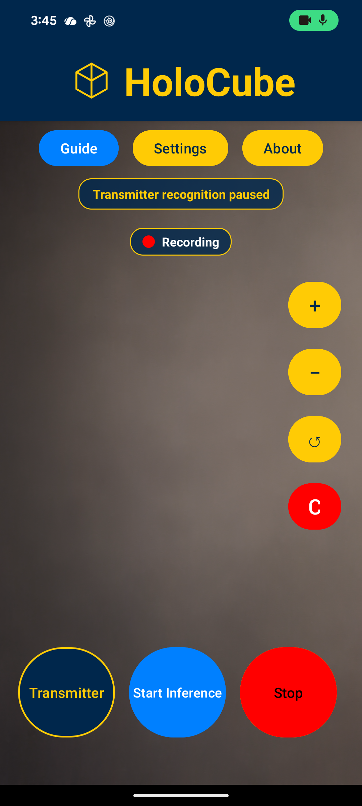
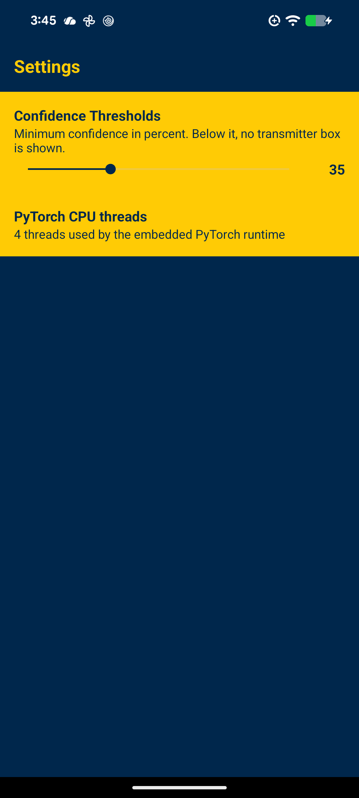
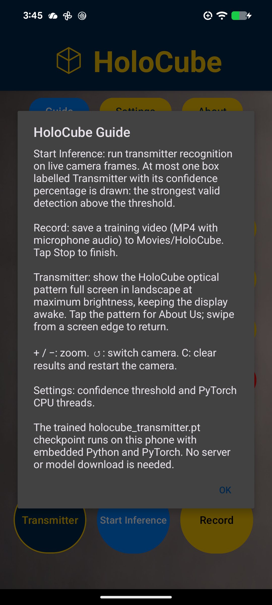
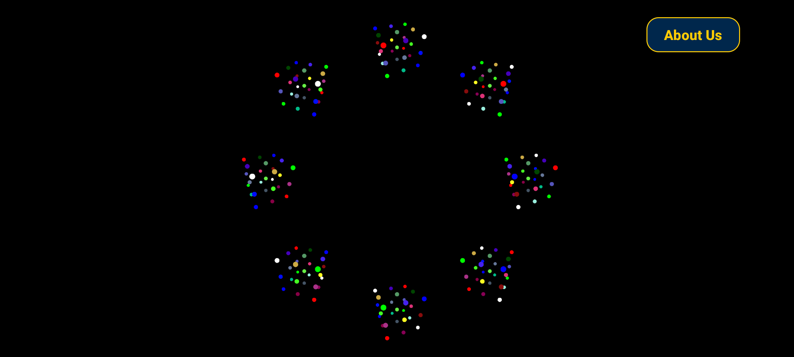
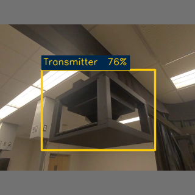
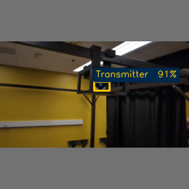

# HoloCube Android


The Android phone edition of [**HoloCube**](https://github.com/denizkarya1999/HoloCube),
the Meta Quest 3 / 3S **Transmitter Recognition** app. It identifies the HoloCube
transmitter in the phone camera image and draws at most one box labelled
**Transmitter** with its confidence percentage over the live preview: the
highest-confidence valid detection above the selected threshold. The camera, trained
model, and detection code all run on the phone, offline. The APK embeds Python,
PyTorch, and the supplied **`holocube_transmitter.pt`** checkpoint unchanged; the
same runtime, startup reference check, and decoder rules as the headset. The model
has one class, `0: Transmitter`, and uses the YOLO26n architecture.

The app also contains the **HoloCube Transmitter**: the **Transmitter** button shows
the supplied 1920 × 1200 optical pattern full screen in landscape at maximum
brightness and keeps the display awake, exactly as the former standalone Transmitter
phone app did. One phone can therefore act as the transmitter while a headset or a
second phone recognizes it.

The app is built with the same technologies, UI, and code structure as
[**LiFind**](https://github.com/denizkarya1999/LiFind): Kotlin, Camera2 with a
`TextureView` preview, an OpenCV frame processor, a `PreferenceFragmentCompat`
settings page, a Material 3 theme in Michigan Blue (`#00274C`) and Michigan Maize
(`#FFCB05`), and JUnit tests.

**Website:** <https://denizkarya1999.github.io/> · **Lab:** <https://www.zhangxiao.me/>

`#HoloCube` `#TransmitterRecognition` `#Android` `#Kotlin` `#YOLO26` `#PyTorch`
`#Chaquopy` `#OpenCV` `#Camera2` `#ObjectDetection` `#ComputerVision` `#OnDeviceAI`
`#OpticalIoT` `#PeppersGhost` `#MixedReality` `#UMichDearborn` `#TrustworthyAIoTLab`

## What it does

Every headset function has a phone counterpart. Controller buttons become on-screen buttons.

| Quest 3 / 3S app | HoloCube Android |
| --- | --- |
| Passthrough camera → transmitter detector → one AR box | Phone camera → transmitter detector → one box over the live preview |
| **A**: toggle transmitter recognition | **Start Inference / Stop Inference** button; "Inference Mode: Off" shows for three seconds |
| Hold **B**: record training video (MP4 with microphone in `Movies/HoloCube`) | **Record / Stop** button, red "Recording" badge, saved filename shown for six seconds |
| **X**: About HoloCube | **About** page with the same project details and tappable links |
| **Y**: Settings (confidence threshold) | **Settings** page with a confidence slider and PyTorch CPU threads |
| **Menu**: Controller Guide | **Guide** dialog |
| Startup reference check of the trained checkpoint | Same check; the status line reports model loading and errors |
| — | Zoom, front/back switch, and **C** to clear, as in LiFind |
| HoloCube Transmitter (separate phone app) | **Transmitter** button: the optical pattern full screen, landscape, maximum brightness, screen kept awake; tap it for About Us |
| — | **Settings → Model Testing → In-Device Local File Inference**: open a test image stored on the phone (or share an image to HoloCube) and run the Transmitter Detection Model on it; the box, its confidence, and the inference time are shown. Other models will be listed there as they are added. |

Since version 1.1 the recognition target is the transmitter's **central pyramid** (the
black inverted hologram prism inside the cube frame) as labelled in the supplied
dataset; the frame, bracket, and rail lie outside the box. Version 1.0 boxed the whole
assembly. The app does not decode optical data or identify individual transmitters;
the paper's optical data transmission and control channel remain future work, as in
the headset app.
Further models are planned for this app: `TransmitterHelper` owns the current one,
and its parser already accepts any class count and box limit, so another model is
added as a sibling helper with its own checkpoint, class list, and reference fixture.

## Research inspiration

Inspired by **Dr. Xiao Zhang, Li Xiao, and Matt W. Mutka**, *HoloCube: 3D Optical
IoT Connections via Software Defined Pepper's Ghost* (ICNP 2024).
[Read the paper](https://www.zhangxiao.me/data/ICNP24_HoloCube.pdf). This independent
prototype is not the authors' official implementation.

## Start here

Open this folder in Android Studio. Read these three files in order:

| Part | File | Its job |
| --- | --- | --- |
| **1. Main screen** | `app/src/main/java/com/developer27/holocube/mobile/MainActivity.kt` | Open the camera, grab preview frames, show the result and controls. |
| **2. Frame processing** | `.../videoprocessing/VideoProcessor.kt` | Letterbox the frame, run the model, draw the box with OpenCV. |
| **3. Model** | `.../videoprocessing/TransmitterHelper.kt` | Own the PyTorch runtime, the class name, and the single-box output parser. |

The complete flow is:

```text
Camera2 preview (TextureView) → MainActivity → VideoProcessor → at most one DetectionResult
                                                     ↑                     ↓
                                    PyTorchWorker + holocube_runtime.py   OpenCV box + label
                                    (holocube_transmitter.pt)             over the preview
```

`MainActivity.processFrameWithVideoProcessor()` runs on every preview update while
inference is on. `VideoProcessor` processes one frame at a time on a coroutine, the
Python worker runs PyTorch on its own thread, and the annotated overlay comes back on
the main thread.

## Where things live

```text
HoloCube_Android/
├── app/src/main/
│   ├── java/com/developer27/holocube/mobile/
│   │   ├── MainActivity.kt                 Camera → recognition → display, all controls
│   │   ├── AboutHoloCubeActivity.kt        Project details and links
│   │   ├── SettingsActivity.kt             Confidence threshold, CPU threads, Model Testing entry
│   │   ├── LocalFileInferenceActivity.kt   In-Device Local File Inference: open an image, run a model, show the box
│   │   ├── camera/
│   │   │   ├── CameraHelper.kt             Camera2 open/close, preview, zoom, switch, record session
│   │   │   └── VideoRecorder.kt            Training video (MP4 + microphone) to Movies/HoloCube
│   │   ├── transmitter/
│   │   │   ├── TransmitterActivity.kt      The optical pattern screen (former HoloCube Transmitter app)
│   │   │   └── FullscreenActivity.kt       Keep awake, full brightness, cutouts, hidden system bars
│   │   └── videoprocessing/
│   │       ├── VideoProcessor.kt           Frame → letterbox → PyTorch → OpenCV drawing
│   │       ├── TransmitterHelper.kt        Runtime, class name, single-box parser (no second NMS)
│   │       ├── LocalInferenceModel.kt      The models offered on the Local File Inference screen
│   │       ├── PyTorchWorker.kt            One background thread for Python/PyTorch
│   │       ├── ImageLetterbox.kt           Fit the frame into 320 × 320; map the box back
│   │       └── BitmapToRgbaTensor.kt       OpenCV letterbox → RGBA bytes for Python
│   ├── python/
│   │   ├── holocube_runtime.py             Pixels → PyTorch → detection rows
│   │   ├── checkpoint_runtime.py           Load the trained .pt and run its layers
│   │   ├── holocube_transmitter.pt         Trained transmitter checkpoint (unchanged)
│   │   ├── reference.f32 / reference.json  Startup parity fixture (bright transmitter frame)
│   │   └── YOLO-LICENSE.txt                Ultralytics AGPL-3.0 license
│   ├── assets/
│   │   ├── transmitter.names.txt           Single class: Transmitter
│   │   └── provenance.json                 Source, dataset, runtime versions, checksum
│   └── res/                                LiFind-style layouts, preferences, theme, transmitter_frame.png
├── app/src/test/                           JUnit: letterbox geometry, single-box parsing
├── app/src/androidTest/                    Device: checkpoint load, angled/low-light parity, camera lifecycle, transmitter screen
├── Tools/setup-python.sh                   Isolated Python 3.8 for Chaquopy's pip step
├── Docs/DEVELOPMENT.md                     Versions, runtime flow, headset differences
├── Screenshots/                            Pixel 8a screenshots 1.png … 8.png
├── VALIDATION.md                           Checks actually performed
├── .github/workflows/android.yml           CI: unit tests, debug APK, lint
└── LICENSE                                 AGPL-3.0 (see Credits and licenses)
```

## Technologies, matched to LiFind

| Area | LiFind | HoloCube Android |
| --- | --- | --- |
| Language and build | Kotlin, Gradle Kotlin DSL, ViewBinding | Same (Kotlin 1.9.22, AGP 8.7.1, Gradle 8.9) |
| Camera | Camera2 `CameraHelper` with `TextureView`, zoom, front/back | Same helper, plus a MediaRecorder session for training videos |
| Frame processing | `VideoProcessor` coroutine + OpenCV drawing | Same structure; OpenCV also letterboxes the model input |
| Model runtime | TFLite (LiteRT) interpreters | Embedded Python/PyTorch loading the supplied `.pt` (Chaquopy), as on the Quest |
| Output parsing | `YOLOLEDHelper.parseTFLite` | `TransmitterHelper.parseRows` (end-to-end head, strongest valid box only) |
| Settings | `PreferenceFragmentCompat`, yellow preference rows | Same, with a `SeekBarPreference` confidence slider |
| About | ConstraintLayout card, U-M logo, lab link | Same, with HoloCube's fields; the HoloCube title opens the website |
| Theme | Material 3, splash screen, Michigan colours | Same |
| Tests | JUnit parser tests, device regression test | Same pattern, plus on-device parity with the Ultralytics reference boxes |

## Build, install, and use

Android app ID: `com.developer27.holocube.mobile`. The former standalone HoloCube
Transmitter app is part of this app (the **Transmitter** button), so one install covers
both roles.

1. Clone this repository and run `bash Tools/setup-python.sh` (creates an isolated
   Python 3.8 for Chaquopy's pip step). Open the folder in **Android Studio** with
   Android SDK 34 and a JDK 17, or build from a terminal:

   ```sh
   ./gradlew :app:testDebugUnitTest :app:assembleDebug :app:lintDebug
   ```

2. Install on a phone with USB debugging enabled:

   ```sh
   adb -s PHONE_SERIAL install -r app/build/outputs/apk/debug/app-debug.apk
   adb -s PHONE_SERIAL shell am start -n com.developer27.holocube.mobile/.MainActivity
   ```

3. Open **HoloCube** (the launcher label) and allow camera access. The status line shows
   *Loading object detection…* while the checkpoint loads and its startup check runs,
   then *Ready*.
4. Press **Start Inference** and point the phone at the transmitter. One box labelled
   **Transmitter** with its confidence percentage appears over the preview, with the
   count and inference time in the status line. No box is drawn below the confidence
   threshold. Press **Stop Inference** to pause; *Inference Mode: Off* disappears after
   three seconds.
5. Press **Record** to record a training video. Allow microphone access the first time.
   A red *Recording* badge appears; press **Stop** to save. MP4s are saved in
   `Movies/HoloCube` and the filename is shown for six seconds.
6. **Transmitter** shows the optical pattern full screen in landscape. The screen stays
   awake at maximum brightness while it is visible; tap the pattern to reveal **About
   Us**, and swipe from a screen edge, then press Back, to return to the camera. The
   pattern is static; it does not encode or send changing data.
7. **C** clears results and restarts the camera. **Settings** adjusts
   **Confidence Thresholds** (5–100 %) with a slider and the PyTorch CPU thread count.
   **About** shows the project details; tapping the **HoloCube** title there (or on the
   main screen) opens the developer's website. **Guide** lists the controls.
8. **Settings → Model Testing → In-Device Local File Inference** tests a model without
   the camera: choose the model (only the Transmitter Detection Model today), press
   **Open Image**, and pick any image on the phone. The screen runs the same letterbox,
   Python runtime, and single-box parser as the live view and shows the annotated image,
   the box in image pixels, its confidence, and the inference time; **Run Again** repeats
   it after a settings change. Opening an image *with* HoloCube from a file manager, or
   sharing one to it, lands on the same screen. The development phone carries 18 frames of
   the pyramid dataset's testing split in `Pictures/HoloCube Test Dataset` for this
   purpose (copied with `adb push`; the dataset itself is not in this repository).

The weights and class name are included in the app; no server or model download is
needed. The debug APK is about 100 MB because it carries the Python and PyTorch runtime.

## Verify

```sh
./gradlew :app:testDebugUnitTest                      # letterbox and single-box parser tests
ANDROID_SERIAL=PHONE_SERIAL ./gradlew :app:connectedDebugAndroidTest
adb -s PHONE_SERIAL logcat -s HoloCube                # HOLOCUBE_PT_*, HOLOCUBE_TRANSMITTER_*, HOLOCUBE_VIDEO_* markers
```

The device tests load the trained checkpoint, confirm the startup reference check,
compare the angled and low-light validation frames with the independent Ultralytics
boxes through the app's own RGBA path, run two inferences, exercise camera switching,
pause, and resume, and check the Transmitter screen (whole image in landscape, keep-awake
and brightness flags, About Us navigation, controls auto-hide). See
[VALIDATION.md](VALIDATION.md) for the recorded results.

## Pixel 8a screenshots

Captured on a Google Pixel 8a (Android 17) on November 4, 2026, in the
[Screenshots](Screenshots) folder.

| | | |
| --- | --- | --- |
| **1** Ready  | **2** Live inference status  | **3** Recording  |
| **4** Settings  | **5** About  | **6** Guide  |

**7** Transmitter screen (landscape, About Us revealed by a tap):



**8** Transmitter found on the phone: the angled validation frame, run on the Pixel 8a
through the app's own OpenCV letterbox, Python runtime, single-box parser, and drawing
by the end-to-end device test. One box, **Transmitter 76%**, at the reference position.
This screenshot was taken with the version 1.0 model and its whole-assembly fixture.



**9** The same end-to-end device test with the version 1.1 pyramid-only model and its new
angled fixture, run on the Pixel 8a on November 7, 2026: one box, **Transmitter 91%**,
around the central pyramid only.



The live-inference screenshot shows the status line (**0 transmitters · 149 ms**)
while the camera looked at the ceiling; no box is drawn without a transmitter in view.

## Label

The model predicts one class, `0: Transmitter`, listed in
[transmitter.names.txt](app/src/main/assets/transmitter.names.txt). The runtime
refuses any checkpoint whose class mapping differs. The general 80-class COCO model of
the earlier HoloCube releases is not packaged.

## Credits and licenses

- Python runtime, trained checkpoint, class name, parity fixtures, and wording come
  from the [HoloCube Quest app](https://github.com/denizkarya1999/HoloCube); the
  checkpoint's dataset context and checksum are in `app/src/main/assets/provenance.json`.
- Project structure, camera helper, processor layout, preferences, and About screen
  follow [LiFind](https://github.com/denizkarya1999/LiFind).
- The Transmitter screen and its optical pattern (`transmitter_frame.png`, SHA-256
  `7b25031ad241596fe8f22cfa3d14c8229c419091e95fff5116146b389f6d6c6e`) come from the
  former standalone HoloCube Transmitter app, now merged here.
- The checkpoint was trained with Ultralytics YOLO26 and the Python layer methods are
  adapted from Ultralytics, both under
  [Ultralytics' AGPL-3.0 or Enterprise licensing](https://docs.ultralytics.com/models/yolo26/);
  the license is included beside the weights and as the repository [LICENSE](LICENSE).
- OpenCV (Apache-2.0), Chaquopy (MIT), Python, PyTorch, and NumPy keep their upstream
  licenses.
